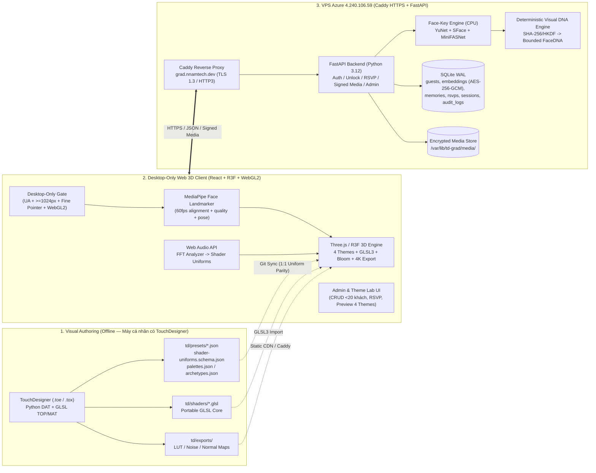
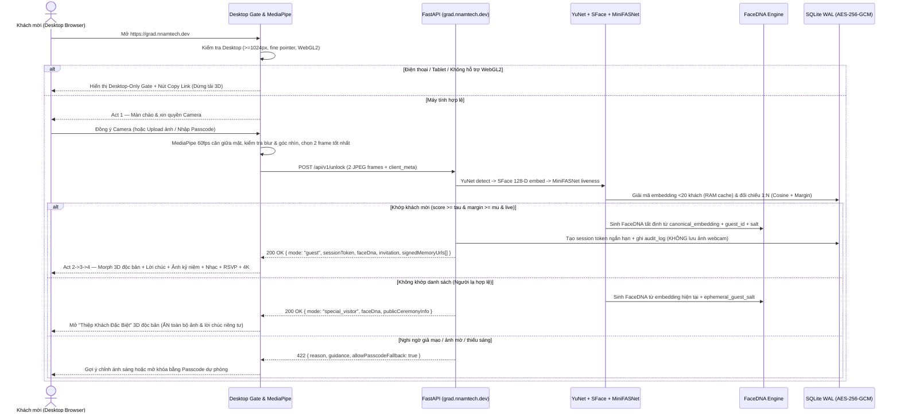
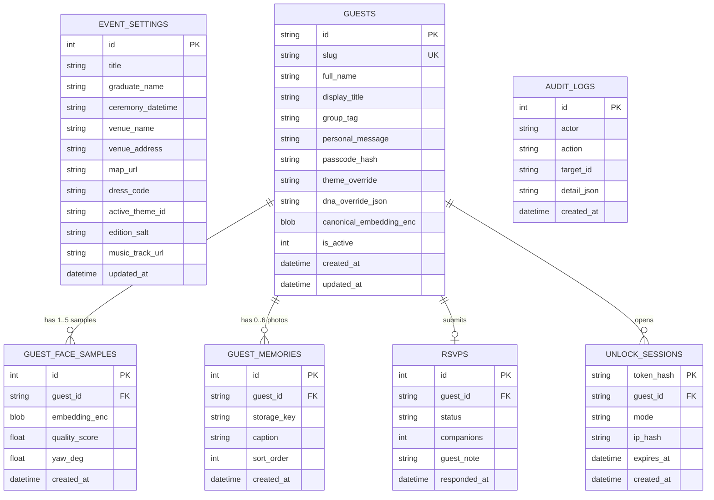

# PRD — Thiệp Mời Tốt Nghiệp 3D Đa Chiều (Hybrid TouchDesigner + Desktop Web 3D & Dual Face-Key)

- **Mã dự án**: `td-grad-invitation` (`TDGRAD`)
- **Phiên bản tài liệu**: `1.0.0`
- **Ngày lập**: `2026-11-25`
- **Trạng thái**: Sẵn sàng cho giai đoạn SpecKit Plan / Implementation
- **Tên miền triển khai mục tiêu**: `https://grad.nnamtech.dev` (trên VPS Azure `4.240.106.59` qua Caddy Auto HTTPS)
- **Phạm vi thiết bị**: **Desktop / Laptop Only** (chặn điện thoại & máy tính bảng có chủ đích)

---

## 1. Tóm tắt điều hành & 12 Quyết định kiến trúc đã chốt

Dự án xây dựng một trải nghiệm **thiệp mời tốt nghiệp 3D đa chiều tương tác trực tiếp trên trình duyệt máy tính**, kết hợp khả năng sáng tác hình ảnh/shader chuyên sâu của **TouchDesigner** với tính tức thời, sắc nét **60fps / xuất ảnh 4K** của **WebGL2 (Three.js / React Three Fiber)**. Điểm lõi tạo khác biệt là cơ chế **Dual Face-Key**: chỉ cần **1 đường dẫn chung duy nhất**, khách mời mở máy tính, soi khuôn mặt trước webcam để hệ thống tự nhận diện 1:N, mở khóa đúng nội dung cá nhân hóa của riêng họ, đồng thời biến chính đặc trưng khuôn mặt thành **Visual DNA** sinh ra một tác phẩm 3D độc bản không trùng lặp giữa bất kỳ hai khách mời nào.

### Bảng khóa 12 quyết định từ khảo sát ngữ cảnh

| # | Hạng mục | Quyết định đã chốt |
| :---: | :--- | :--- |
| **Q1** | Quy mô khách mời | **Nhóm nhỏ thân mật (< 20 khách)**, ưu tiên mức độ cá nhân hóa sâu sắc cho từng người. |
| **Q2** | Art Direction 3D | Chưa khóa cứng 1 phong cách ngay — xây dựng **Theme Lab** để thử nghiệm trực quan **cả 4 hướng thẩm mỹ 3D** trước khi chốt bản gửi khách. |
| **Q3** | Bộ tính năng thiệp | **Gói đầy đủ**: Lời chúc cá nhân, Ảnh kỷ niệm chung với từng khách, Chi tiết buổi lễ (ngày/giờ/bản đồ/dress code), Form xác nhận tham dự (RSVP), Nhạc nền phản ứng 3D (Audio-Reactive), Nút chụp ảnh thiệp lưu niệm **4K (`3840×2160`)**. |
| **Q4** | Cơ chế chia sẻ link | **1 đường dẫn chung duy nhất** (ví dụ `https://grad.nnamtech.dev`) — tự nhận diện **1:N** bằng khuôn mặt. |
| **Q5** | Kiến trúc Face Match | **Hybrid Client + Server**: Trình duyệt chạy **MediaPipe Face Landmarker** (60fps) để căn chỉnh, đánh giá chất lượng/tư thế và chọn frame rõ nhất; gửi frame về **FastAPI Server** chạy **YuNet + SFace** (tái dụng từ dự án `FaceGate v4`) để so khớp 1:N và giải khóa dữ liệu riêng tư mà không lộ danh sách khách ra client. |
| **Q6** | Quản trị & nạp ảnh mẫu | **Trang Admin nội bộ** (bảo vệ bằng mật khẩu/token): thêm < 20 khách, upload 1–5 ảnh mẫu/khách, soạn lời chúc, gắn ảnh kỷ niệm, xem bảng RSVP và mở **Theme Lab** xem trước 3D của từng khách. |
| **Q7** | Luồng ngoại lệ & Người lạ | **3 lớp dự phòng thông minh**: (1) Không có webcam → cho tải 1 ảnh chân dung; (2) Ánh sáng yếu/khó nhận → nút nhập **Mã mời dự phòng (Passcode)**; (3) Người ngoài danh sách (< 20 người) → vẫn mở được bản **"Thiệp Khách Đặc Biệt"** 3D độc bản theo khuôn mặt họ nhưng **ẩn tuyệt đối** ảnh kỷ niệm & lời chúc riêng tư của các khách khác. |
| **Q8** | Anti-Spoofing & Bảo mật | **Cân bằng tốc độ (1.5–2.5s) & an toàn**: kiểm tra tư thế nhẹ phía client + **MiniFASNet** thụ động trên server, mã hóa embedding nghỉ bằng **`AES-256-GCM`**, **không lưu** ảnh webcam của khách sau khi xác thực, phục vụ ảnh kỷ niệm qua **Signed URL có hạn ngắn theo phiên**. |
| **Q9** | Vai trò TouchDesigner | **Visual Authoring & Shader/Asset Engine**: Dùng bản TouchDesigner Non-Commercial (miễn phí, preview ≤ `1280×1280`) để thiết kế 4 theme 3D, GLSL shaders, procedural textures/LUT/displacement maps & camera curves; xuất GLSL/JSON sang WebGL2 để render mượt toàn màn hình và chụp lưu niệm **4K** không bị giới hạn độ phân giải. |
| **Q10** | Tech Stack | **Frontend**: React 19 + TypeScript + Vite + Three.js (`@react-three/fiber`, `@react-three/drei`, `@react-three/postprocessing`, GLSL3) + Web Audio API + MediaPipe Tasks Vision.<br>**Backend**: Python 3.10+ FastAPI + OpenCV (`YuNet`, `SFace`) + ONNX Runtime (`MiniFASNet V2/V1SE`) + `cryptography` (`AES-256-GCM`) + **SQLite WAL**. |
| **Q11** | Hạ tầng & Hiệu năng | Deploy ngay trên **VPS Azure `4.240.106.59`** qua **Caddy Auto HTTPS** (`grad.nnamtech.dev`), hỗ trợ tốt **3–10 khách đồng thời**, mục tiêu **60fps ổn định** trên laptop iGPU phổ thông (Intel Iris Xe / AMD Radeon / Apple Silicon). |
| **Q12** | Đầu ra & Đồng bộ | Xuất đồng bộ `docs/PRD.md`, `docs/PRD.html` (kèm sơ đồ Mermaid) và nạp tóm tắt kiến trúc vào Shared Team Memory `dept:td-grad-invitation` trên MSW Team Server (`https://nnamtech.dev`). |

---

## 2. Mục tiêu sản phẩm & Ràng buộc phi chức năng

### 2.1 Mục tiêu cốt lõi
1. **Ấn tượng thị giác cá nhân hóa tuyệt đối**: Mỗi trong số < 20 khách mời khi mở thiệp sẽ nhận ra ngay đây là một tác phẩm 3D dành riêng cho mình (hình khối, dải màu, chuyển động hạt, lời chúc và ảnh kỷ niệm chung).
2. **Nhất quán giữa các lần truy cập**: Cùng một khách mời quay lại mở thiệp nhiều lần vẫn nhận đúng một cấu hình 3D signature (tất định từ `canonical_embedding` đã đăng ký), không bị "nhảy" thiết kế lung tung do nhiễu ánh sáng webcam.
3. **Trải nghiệm máy tính trọn vẹn (Desktop-Only)**: Khai thác tối đa màn hình rộng, chuột/trackpad (orbit/parallax), bàn phím, webcam chất lượng cao và GPU tích hợp trên laptop/PC; loại bỏ hoàn toàn trải nghiệm bị bóp méo hoặc crash WebGL trên điện thoại.
4. **Quy trình sản xuất Git-Native**: Tách toàn bộ logic Python, GLSL shader và JSON preset khỏi tệp nhị phân `.toe` để đội ngũ AI + lập trình viên có thể review diff, kiểm thử tự động và phát hành liền mạch.

### 2.2 Chỉ số thành công (Success Metrics)

| Hạng mục | Chỉ tiêu mục tiêu | Cách đo kiểm |
| :--- | :--- | :--- |
| Thời gian quét & mở khóa Face-Key | `1.5 – 2.5 giây` (từ lúc mặt vào khung đến khi chuyển cảnh 3D) | Telemetry thời gian `capture -> /api/v1/unlock -> sceneReady` |
| Độ chính xác nhận diện 1:N (< 20 khách) | FAR `0%` (không nhận nhầm người A sang người B), FRR `< 5%` ở ánh sáng phòng bình thường | Bộ test ngưỡng cosine + margin (`top1 - top2`) & replay test trên ảnh mẫu |
| Hiệu năng Web 3D trên máy tính | `≥ 55–60 FPS` ở `1080p` trên Intel Iris / Radeon iGPU; bộ nhớ GPU ổn định khi đổi theme | Chrome DevTools Performance + WebGL `renderer.info` sau 10 lần chuyển theme |
| Thời gian tải lần đầu (First Load) | `< 3.5 giây` cho Shell + Desktop Gate; tải lười (lazy-load) asset 3D & MediaPipe WASM | Lighthouse / Network waterfall qua HTTPS HTTP/2+HTTP/3 Caddy |
| Chất lượng ảnh lưu niệm 4K | Xuất đúng `3840×2160` PNG (không vỡ chữ, không lỗi WebGL context lost) | Offscreen render target / temporary high-res pass test trên laptop 8–16 GB RAM |

---

## 3. Kiến trúc tổng thể hệ thống

Hệ thống gồm **4 lớp phối hợp chặt chẽ**, chia tách rõ giữa **môi trường sáng tác ngoại tuyến (TouchDesigner)** và **hệ thống vận hành 24/7 trên VPS Azure**:



### Luồng mở khóa Dual Face-Key (Sequence)



---

## 4. Chi tiết công nghệ & Lý do lựa chọn (Tech Stack Matrix)

| Tầng hệ thống | Công nghệ lựa chọn | Phiên bản / Thành phần | Lý do kỹ thuật |
| :--- | :--- | :--- | :--- |
| **Visual Authoring** | **TouchDesigner** | Non-Commercial (2023.11+ / 2024+) | Sáng tác nhanh hiệu ứng generative, GLSL TOP/MAT, particle/SDF, LUT và camera curves trực quan; không tốn chi phí bản quyền nhờ xuất shader/preset sang WebGL2. |
| **Frontend Core** | **React + TypeScript + Vite** | React 19, TypeScript 5.x, Vite 6 | Tốc độ dev nhanh cho Theme Lab & Admin UI, kiểm soát kiểu dữ liệu chặt chẽ cho hợp đồng `FaceDNA` và uniform shader. |
| **Web 3D Engine** | **Three.js + React Three Fiber** | `three`, `@react-three/fiber`, `@react-three/drei`, `@react-three/postprocessing` | Hệ sinh thái WebGL2 trưởng thành, hỗ trợ GLSL3 (`#version 300 es`), instancing, PBR glass/transmission, Bloom/ChromaticAberration và tách scene sạch theo từng Theme. |
| **Audio-Reactive** | **Web Audio API** | `AudioContext` + `AnalyserNode` (FFT 256) | Tách 3 dải tần (`uAudioBass`, `uAudioMid`, `uAudioTreble`, `uAudioEnergy`) mượt 60fps để thiệp 3D nhấp nhô/phát sáng theo nhạc tốt nghiệp. |
| **Client Face UX** | **MediaPipe Tasks Vision** | `@mediapipe/tasks-vision` (Face Landmarker WASM) | Chạy 60fps ngay trên trình duyệt để vẽ vòng dẫn hướng căn mặt, đo độ nghiêng/độ mờ và chỉ gửi frame đẹp lên server (giảm tải mạng & tăng tỷ lệ khớp). |
| **Backend API** | **Python FastAPI + Uvicorn** | Python 3.12, FastAPI ≥ 0.110, Pydantic v2 | Tái sử dụng trực tiếp kinh nghiệm & mô hình thương mại sạch từ `msoftware-ai-camera-attendance`. |
| **Server Face AI** | **OpenCV Zoo + ONNX Runtime** | `YuNet` (MIT) + `SFace` (Apache-2.0) + `MiniFASNet V2/V1SE` (Apache-2.0) | Chạy cực nhanh trên **CPU VPS Azure** (~40–80ms/frame), giấy phép thương mại hoàn toàn hợp lệ, đã được kiểm chứng thực tế trên `FaceGate v4`. |
| **Cơ sở dữ liệu** | **SQLite (WAL Mode)** | SQLite 3 + `PRAGMA journal_mode=WAL` | Dư sức phục vụ < 20 khách và 3–10 kết nối đồng thời, backup 1 file gọn nhẹ, không tốn RAM chạy Postgres trên VPS. |
| **Bảo mật** | **AES-256-GCM + HMAC-SHA256** | `cryptography` (tái dụng `BiometricCipher`), Signed URL, Rate Limit | Bảo vệ vector sinh trắc học nghỉ, khóa cứng ảnh kỷ niệm theo phiên, ngăn brute-force Passcode & Face Unlock. |
| **Triển khai** | **Caddy + Systemd trên VPS Azure** | VPS `4.240.106.59`, `grad.nnamtech.dev` | Tận dụng sẵn hạ tầng Azure + Caddy Auto HTTPS hiện có của bạn (chỉ thêm 1 bản ghi DNS `A` `grad` → `4.240.106.59` và 1 block trong `Caddyfile`). |

---

## 5. Thiết kế Trải nghiệm 4 Hồi & Hệ thống Theme Lab

### 5.1 Desktop-Only Gate (Chặn thiết bị di động có chủ đích)
Kiểm tra **ngay ở entrypoint trước khi nạp Three.js / MediaPipe WASM**:
1. **Điều kiện chặn**:
   - Mobile/Tablet UA (`/Android|webOS|iPhone|iPad|iPod|BlackBerry|IEMobile|Opera Mini/i`) hoặc iPadOS giả desktop (`navigator.platform === 'MacIntel' && navigator.maxTouchPoints > 1`).
   - Khung nhìn nhỏ hơn chuẩn máy tính: `window.innerWidth < 1024 || window.innerHeight < 620`.
   - Thiết bị chỉ có con trỏ thô: `matchMedia('(pointer: coarse)').matches && !matchMedia('(any-pointer: fine)').matches`.
   - Trình duyệt không khởi tạo được `webgl2`.
2. **Giao diện khi bị chặn**: Trang tĩnh tinh tế bằng tiếng Việt giải thích *"Thiệp mời 3D này được thiết kế độc quyền cho màn hình và GPU máy tính để mang lại trải nghiệm trọn vẹn nhất"*, hiển thị rõ tên sự kiện, mã QR ngược/nút **"Sao chép đường dẫn để mở trên máy tính"** và thông tin liên hệ nhanh.

### 5.2 Hành trình trải nghiệm 4 Hồi (Desktop 100%)
1. **Hồi 1 — Arrival & Camera Consent (`0–3s`)**:
   - Không gian nền tối giản mang hơi thở sự kiện tốt nghiệp, lời chào mở đầu, thông báo quyền riêng tư rõ ràng (*"Ảnh khuôn mặt chỉ dùng để mở khóa & sinh thiết kế 3D, không được lưu trữ"*).
   - 3 lựa chọn gọn gàng: **[Bật Camera mở thiệp]** (chính), **[Tải ảnh chân dung]** (nếu PC không có webcam), **[Nhập mã mời dự phòng]** (nếu ngược sáng/thiếu sáng).
2. **Hồi 2 — Face-Key Scan & Generative Morph (`1.5–2.5s`)**:
   - Khung ngắm hình học phản hồi thời gian thực theo 468 điểm mốc MediaPipe (nhắc nhẹ *"Tiến gần hơn"*, *"Nhìn thẳng camera"*).
   - Ngay khi server trả về `FaceDNA`, các hạt ánh sáng tụ lại và biến hình mượt (morph shader) thành **Tác phẩm 3D Độc Bản** mang tên khách mời.
3. **Hồi 3 — Multi-Dimensional 3D Exploration (60fps)**:
   - Xoay/kéo đa chiều mượt có quán tính (`OrbitControls` có damping), zoom có giới hạn an toàn, hiệu ứng parallax nhẹ theo con trỏ chuột (hoặc góc đầu tùy chọn).
   - Phím tắt cho máy tính: `R` (đặt lại góc nhìn), `Space` (bật/tắt tự xoay), `1 / 2 / 3` (chuyển 3 góc máy điện ảnh được định nghĩa từ camera rig), `M` (bật/tắt nhạc nền phản ứng 3D).
   - Thanh điều khiển kín đáo ở đáy màn hình: Xem **Lời chúc & Ảnh kỷ niệm**, xem **Chi tiết lễ & Bản đồ**, mở **Form RSVP**, và **Chụp thiệp lưu niệm 4K**.
4. **Hồi 4 — Personal Card, Kỷ niệm, RSVP & Xuất ảnh 4K**:
   - **Thiệp cá nhân hóa**: Lời chúc viết riêng cho từng người, bộ sưu tập 1–6 ảnh kỷ niệm chung (tải qua Signed URL, trình chiếu mượt kèm chú thích).
   - **Chi tiết buổi lễ**: Ngày/giờ, địa điểm, link Google Maps, dress code, nút thêm vào Google Calendar / file `.ics`.
   - **Form RSVP**: Chọn *Sẽ tham dự / Tiếc quá không dự được*, số người đi kèm (nếu cho phép), lời nhắn gửi lại chủ nhân buổi lễ (lưu vào SQLite và hiện ngay trên trang Admin).
   - **Xuất thiệp lưu niệm 4K (`3840×2160` PNG)**: Render 1 khung hình sắc nét ở độ phân giải 4K kèm khung chữ ký nghệ thuật (*Tên khách mời + Mã Visual DNA ngắn + Lễ Tốt Nghiệp 2026*) và tải trực tiếp về máy tính.

### 5.3 Theme Lab (Hệ thống thử nghiệm 4 phong cách 3D)
Vì bạn muốn **thử trực tiếp toàn bộ 4 phong cách** trước khi chốt bản gửi khách, kiến trúc Frontend & TouchDesigner tách biệt hoàn toàn **dữ liệu `FaceDNA`** khỏi **Theme Renderer** thông qua một interface chung `InvitationThemeRenderer`:

| Theme ID | Tên phong cách | Đặc trưng Shader / Hình khối | Cách `FaceDNA` biến hóa theo từng khách |
| :--- | :--- | :--- | :--- |
| **`crystal-glass`** | **Bioluminescent Crystal & Cosmic Glass** | Nền tối sâu, vật liệu kính/pha lê khúc xạ (`MeshPhysicalMaterial` transmission + custom Fresnel/iridescence shader), dải hạt phát quang + Bloom mềm | Đổi cấu trúc tinh thể (số mặt cắt, độ vặn xoắn), dải màu phát quang kép & mật độ sao nền |
| **`editorial-gallery`** | **Minimal Architectural Gallery** | Không gian phòng triển lãm sáng tối giản (trắng/kem/đá mờ), ánh sáng studio mềm, khối điêu khắc 3D dạng gốm/kim loại xước + typography tạp chí | Đổi tỷ lệ điêu khắc trừu tượng, sắc độ ánh sáng ấm/lạnh, chất liệu đá/đồng/bạc & bố cục khung biên tập |
| **`cyber-audio`** | **Cybernetic Audio-Reactive Sculpture** | Point-cloud GPU instancing (20k–50k hạt), sóng trường vector (curl noise) & lưới wireframe phản ứng mạnh theo FFT âm thanh và chuột | Đổi công thức attractor/trường xoáy hạt, nhịp rung theo bass/treble và cặp màu neon hài hòa |
| **`multi-archetype`** | **Multi-Archetype Generative DNA** | Tự động chọn 1 trong 5 hình thái 3D độc lập (`crystalline_prism`, `orbital_ribbon`, `celestial_lattice`, `origami_monolith`, `aurora_sculpt`) | Mỗi khách không chỉ khác màu/thông số mà sở hữu hẳn một hình tượng kiến trúc 3D khác biệt rõ rệt |

- Trong **Admin → Theme Lab** (chỉ Admin thấy, khách mời bình thường không thấy): có thanh chọn **Khách mời bất kỳ** + nút chuyển nhanh **4 Theme** + thanh trượt xem thử thông số `FaceDNA` + nút **"Set Active Production Theme"** (đặt 1 theme mặc định toàn hệ thống, hoặc gán riêng theme cho từng khách mời nếu muốn).

---

## 6. Thiết kế Dual Face-Key & Thuật toán Visual DNA (`FaceDNA`)

### 6.1 Nhận diện 1:N & Chống giả mạo (Server-side CPU)
Tái sử dụng lõi đã chứng minh trên `FaceGate v4`:
1. **Phát hiện & căn chỉnh**: `YuNet` (`face_detection_yunet_2023mar.onnx`) tìm khuôn mặt lớn nhất và 5 mốc chuẩn; từ chối nếu kích thước mặt quá nhỏ (`< 80px`), quá mờ (Laplacian variance `< 35`) hoặc quá nghiêng (`|yaw| > 35°`).
2. **Chống giả mạo cân bằng (1.5–2.5s)**:
   - Phía client: MediaPipe xác nhận khuôn mặt sống nhẹ (chuyển động tự nhiên giữa 2 frame cách nhau ~400–600ms, tránh ảnh tĩnh đứng yên 100%).
   - Phía server: `MiniFASNet V2 + V1SE` chấm điểm liveness trung bình trên 2 frame (`>= 0.60` đạt; `< 0.35` cảnh báo giả mạo và yêu cầu chụp lại hoặc nhập Passcode).
3. **So khớp 1:N (< 20 khách)**:
   - Mỗi khách mời lưu `1–5` vector chuẩn hóa `SFace` (128-D, L2-normalized) + 1 vector trung bình chuẩn hóa (`canonical_embedding`).
   - Tính điểm khớp cao nhất (`top1`) và cao thứ hai (`top2`) theo cosine similarity:
     - **Khớp khách (`mode = "guest"`)**: `top1 >= 0.44` **VÀ** `(top1 - top2) >= 0.07` (với gallery ≥ 2 khách).
     - **Không khớp (`mode = "special_visitor"`)**: `top1 < 0.38` → cấp trải nghiệm **"Thiệp Khách Đặc Biệt"** 3D độc bản theo khuôn mặt hiện tại, **không tiết lộ** bất kỳ dữ liệu riêng nào.
     - **Vùng mơ hồ (`0.38 <= top1 < 0.44` hoặc margin `< 0.07`)**: yêu cầu giữ thẳng mặt/tăng ánh sáng hoặc bấm **Nhập Mã mời dự phòng (Passcode)**.

### 6.2 Thuật toán sinh `FaceDNA` tất định & Rào chắn thẩm mỹ
Để đảm bảo **cùng 1 khách → luôn 1 thiết kế cố định**, **2 khách khác nhau → 2 thiết kế rõ nét khác biệt**, và **100% thiết kế đều đẹp mắt**:

1. **Tạo Seed tất định**:
   - Với khách đã đăng ký: lượng tử hóa `canonical_embedding` (làm tròn 4 chữ số thập phân) rồi băm `HKDF-SHA256(ikm = canonical_embedding_bytes, salt = edition_salt, info = guest_id)` → tạo mảng 32 byte giả ngẫu nhiên ổn định (`S[0..31]`).
   - Với khách vãng lai (`special_visitor`): băm trực tiếp `embedding` đã lượng tử hóa thô (2 chữ số) kèm `visitor_salt` để tạo mã DNA tạm thời.
2. **Ánh xạ vào Curated Design Manifold (không dùng RGB ngẫu nhiên thô)**:
   - **Archetype**: `archetype = ARCHETYPES[S[0] % 5]` (hoặc ghi đè bởi Admin trong Theme Lab).
   - **Bảng màu hài hòa (OKLCH/HSL)**: chọn 1 trong 12–16 bảng màu lễ tốt nghiệp đã hiệu chỉnh tương phản (`paletteId = S[1] % N`) + tinh chỉnh góc sắc độ tinh tế `±12°` từ `S[2]` để không trùng nhau mà chữ vẫn luôn đạt độ tương phản đọc rõ `≥ 4.5:1`.
   - **Kẹp biên Uniform GLSL**: mọi tham số liên tục được nội suy tuyến tính trong khoảng kiểm chứng an toàn, bảo vệ `math.isfinite`.

### 6.3 Hợp đồng JSON `FaceDNA` (Shared Schema giữa Python, TouchDesigner & Three.js)

```json
{
  "schemaVersion": "1.0",
  "dnaCode": "FG-7A9C-2026",
  "mode": "guest",
  "themeId": "crystal-glass",
  "archetype": "crystalline_prism",
  "palette": {
    "id": "midnight-gold-aurora",
    "bgHex": "#070914",
    "primaryHex": "#7C6BFF",
    "accentHex": "#F5C469",
    "highlightHex": "#67E8F9",
    "textHex": "#F8FAFC"
  },
  "uniforms": {
    "uSeed": 0.7421,
    "uNoiseFreq": 1.85,
    "uDisplacement": 0.34,
    "uCrystalFacets": 7,
    "uIridescence": 0.68,
    "uFresnelPower": 2.45,
    "uParticleDensity": 0.76,
    "uOrbitSpeed": 0.42,
    "uBloomStrength": 0.65,
    "uAudioReactivity": 0.55
  },
  "cameraRig": {
    "fov": 42,
    "initialPos": [0.0, 0.4, 5.2],
    "target": [0.0, 0.0, 0.0],
    "presetViews": [
      { "id": "hero", "pos": [0.0, 0.4, 5.2], "target": [0.0, 0.0, 0.0] },
      { "id": "macro", "pos": [1.8, 0.9, 2.9], "target": [0.0, 0.1, 0.0] },
      { "id": "orbit-high", "pos": [-2.4, 2.2, 4.4], "target": [0.0, -0.1, 0.0] }
    ]
  }
}
```

---

## 7. Hợp đồng Đồng bộ TouchDesigner ↔ WebGL2 (Git-Native Parity)

Để khắc phục giới hạn độ phân giải `1280×1280` của TouchDesigner Non-Commercial mà vẫn tận dụng tối đa sức mạnh sáng tác của TD:

1. **Tách mã nguồn khỏi file nhị phân `.toe`**:
   - `td/scripts/invitation_ext.py`: Extension class (`InvitationExt`) gắn lên `InvitationEngine.tox`, có hàm `ApplyFaceDNA(dna_dict)` tự động kiểm tra kiểu, kẹp biên và gán vào Custom Parameters (`parent.Invitation.par.*`).
   - `td/shaders/`: Tách phần hàm toán học dùng chung (`noise.glsl`, `fresnel_glass.glsl`, `sdf_archetypes.glsl`, `particle_curl.glsl`) viết theo chuẩn tương thích ngược giữa TD GLSL 330/450 và WebGL2 GLSL ES 3.00 (`#ifdef TD_ENV ... #else ... #endif`).
   - `td/presets/shader-uniforms.schema.json`: Nguồn chân lý duy nhất định nghĩa tên, kiểu, `min`, `max`, `default` của toàn bộ 10 uniform cốt lõi.
   - `td/exports/`: Xuất các tài nguyên tĩnh dung lượng nhỏ (LUT `.cube`/`.png`, seamless noise/normal/env textures ≤ `1024px`) phục vụ trực tiếp cho cả TD và Three.js.
2. **Quy tắc kiểm chứng Parity tự động**:
   - Script kiểm thử trong CI/SOP đọc `td/presets/shader-uniforms.schema.json` và đối chiếu tự động: mọi uniform khai báo trong `td/shaders/*.glsl` và `web/src/three/shaders/*.glsl` đều khớp tên và phạm vi giá trị 1:1.

---

## 8. Data Model (SQLite WAL) & Thiết kế API

### 8.1 Sơ đồ quan hệ dữ liệu (ERD)



### 8.2 Danh sách API Endpoint chính (FastAPI `/api/v1`)

| Nhóm | Method & Route | Auth | Chức năng & Ghi chú bảo mật |
| :--- | :--- | :---: | :--- |
| **Public** | `GET /api/v1/health` | Public | Kiểm tra trạng thái server, model ONNX đã load, dung lượng đĩa & số khách active (không lộ tên khách). |
| **Public** | `GET /api/v1/event/public` | Public | Trả thông tin mở đầu chung (tiêu đề buổi lễ, tên người tốt nghiệp, trạng thái nhạc) trước khi mở khóa. |
| **Unlock** | `POST /api/v1/unlock/face` | Public + Rate Limit | Nhận `1–2` frame ảnh JPEG từ webcam hoặc ảnh upload; chạy YuNet + SFace + MiniFASNet → trả `mode` (`guest` / `special_visitor`), `sessionToken`, `faceDna`, và (nếu `guest`) nội dung thiệp + Signed URL ảnh kỷ niệm. Xóa ảnh đầu vào ngay khỏi RAM. |
| **Unlock** | `POST /api/v1/unlock/passcode` | Public + Rate Limit | Mở khóa dự phòng bằng mã mời cá nhân (hash Argon2/PBKDF2/HMAC, khóa tạm IP nếu sai quá 5 lần/15 phút). |
| **Session** | `GET /api/v1/media/{memory_id}?sig=...&exp=...` | Signed URL | Phát ảnh kỷ niệm chung của đúng khách mời trong phiên còn hạn (`TTL = 30 phút`). |
| **Session** | `POST /api/v1/rsvp` | `Bearer sessionToken` | Khách xác nhận tham dự (`attending` / `declined`), số người đi kèm và lời nhắn chúc mừng. |
| **Admin** | `POST /api/v1/admin/login` | Admin Secret | Đăng nhập trang quản trị (trả HttpOnly cookie / Bearer token). |
| **Admin** | `GET/POST/PUT/DELETE /api/v1/admin/guests` | Admin | CRUD danh sách < 20 khách, lời chúc, `passcode`, `theme_override`. |
| **Admin** | `POST /api/v1/admin/guests/{id}/faces` | Admin | Upload 1–5 ảnh mẫu để trích xuất `SFace` embedding, tính lại `canonical_embedding`, mã hóa `AES-256-GCM` rồi xóa ảnh thô (hoặc chỉ giữ thumbnail đã mã hóa nếu Admin bật). |
| **Admin** | `POST/DELETE /api/v1/admin/guests/{id}/memories` | Admin | Upload/xóa ảnh kỷ niệm chung với từng khách (tự nén WebP/JPEG tối đa `2048px`). |
| **Admin** | `GET /api/v1/admin/guests/{id}/dna-preview` | Admin | Lấy `FaceDNA` của khách bất kỳ để mở **Theme Lab** test cả 4 phong cách 3D mà không cần giả lập webcam. |
| **Admin** | `PUT /api/v1/admin/event-settings` | Admin | Cập nhật thông tin buổi lễ, nhạc nền, và **Active Production Theme** sau khi chọn xong ở Theme Lab. |
| **Admin** | `GET /api/v1/admin/rsvps` | Admin | Xem tổng hợp danh sách RSVP và xuất CSV (bọc chống CSV formula injection). |

---

## 9. Bảo mật sinh trắc học, Quyền riêng tư & Chống giả mạo

1. **Không rò rỉ dữ liệu giữa các khách mời**:
   - Frontend hoàn toàn **không** tải danh sách tên khách, lời chúc, ảnh kỷ niệm hay embedding xuống trình duyệt trước khi mở khóa.
   - Mọi ảnh kỷ niệm nằm ngoài thư mục tĩnh công khai (`/var/lib/td-grad/media/`), chỉ truy cập được qua `GET /api/v1/media/{id}` kèm chữ ký `HMAC-SHA256(memory_id + session_id + exp)` hết hạn sau 30 phút.
2. **Bảo vệ sinh trắc học ở trạng thái nghỉ & vận hành**:
   - Toàn bộ embedding trong SQLite mã hóa bằng **`AES-256-GCM`** (khóa `GRAD_BIOMETRIC_KEY` đọc từ biến môi trường phân quyền `0600`).
   - Ảnh webcam khách gửi lên `/api/v1/unlock/face` chỉ giải mã trong bộ nhớ RAM và hủy ngay sau khi trả response — **không ghi ra đĩa, không ghi log**.
   - Camera stream trên trình duyệt được dừng sạch (`stream.getTracks().forEach(t => t.stop())`) ngay khi hoàn tất mở khóa hoặc chuyển tab.
3. **Chống lạm dụng & An toàn Web**:
   - Rate limit: tối đa `15 lần/phút/IP` cho `/unlock/face` và `5 lần/15 phút/IP` cho `/unlock/passcode`.
   - CSP chặt, sanitize lời nhắn RSVP & lời chúc (tránh XSS), giới hạn kích thước file upload (`≤ 8 MB`/ảnh), kiểm tra magic bytes JPEG/PNG/WebP.
   - Git Hygiene: `.gitignore` chặn tuyệt đối `data/`, `*.db*`, `.env*`, ảnh khách thật; toàn bộ test dùng vector/ảnh tổng hợp.

---

## 10. Hiệu năng 3D, Xuất ảnh 4K & Triển khai trên VPS Azure (`4.240.106.59`)

### 10.1 Kỷ luật hiệu năng WebGL2 (60fps trên Laptop iGPU)
- Giới hạn `dpr={[1, 2]}` (`Math.min(window.devicePixelRatio, 2)`), tự động giảm chất lượng post-processing (Adaptive Performance) nếu frame time trung bình vượt `22ms` trong 3 giây liên tục.
- Giới hạn particle budget `≤ 35,000` điểm GPU-instanced cho Theme `cyber-audio`; dùng `BufferGeometry` dùng chung và gọi `.dispose()` toàn bộ material/geometry/texture khi chuyển theme trong Theme Lab.
- Bắt sự kiện `webglcontextlost` / `webglcontextrestored` để không bị màn hình trắng.
- **Xuất ảnh lưu niệm 4K (`3840×2160`)**: Render vào một offscreen `WebGLRenderTarget` độ phân giải 4K (1 frame duy nhất, `preserveDrawingBuffer` không bật thường trực để tiết kiệm băng thông GPU), vẽ thêm lớp typography chữ ký 2D qua `<canvas>` offscreen rồi giải phóng `RenderTarget` ngay lập tức.

### 10.2 Hạ tầng triển khai trên VPS Azure `4.240.106.59`
- **DNS Name.com**: Thêm 1 bản ghi `A` cho subdomain `grad` (`grad.nnamtech.dev` → `4.240.106.59`, TTL `300s`).
- **Caddy (`/etc/caddy/Caddyfile`)**:
  ```caddy
  grad.nnamtech.dev {
      encode zstd gzip
      reverse_proxy 127.0.0.1:8100
  }
  ```
  *(Caddy phục vụ cả static bundle Vite đã build hoặc FastAPI mount `web/dist/` + API `/api/v1/*`, tự cấp SSL Let's Encrypt cho `grad.nnamtech.dev` song song hoàn toàn với `nnamtech.dev` hiện tại).*
- **Systemd service**: `td-grad-invitation.service` chạy Uvicorn `127.0.0.1:8100` (1–2 workers, preload model ONNX vào RAM ~250–350 MB, quá nhẹ trên VPS hiện có + 4 GB swap), secrets đặt tại `/var/lib/td-grad/server.env` (`chmod 600`).

---

## 11. Tiêu chí chấp nhận (Acceptance Criteria) & Kế hoạch kiểm thử

| ID | Tiêu chí chấp nhận (Khi … thì hệ thống …) | Cách chứng minh |
| :--- | :--- | :--- |
| **AC-01** | Khi truy cập `grad.nnamtech.dev` trên điện thoại, tablet hoặc cửa sổ `< 1024px`, hệ thống chặn tải WebGL2/webcam và hiển thị màn hình Desktop-Only Gate kèm nút copy link. | Unit test `desktopGate.test.ts` + E2E Playwright mô phỏng mobile UA & viewport `390×844`, `768×1024`. |
| **AC-02** | Khi Admin thêm khách mời và upload 1–5 ảnh mẫu, hệ thống trích xuất `SFace` embedding, lưu mã hóa `AES-256-GCM` vào SQLite và tính `canonical_embedding`. | Pytest `test_admin_enrollment.py` kiểm tra DB raw bytes không chứa float thô. |
| **AC-03** | Khi gọi `generate_face_dna` nhiều lần cho cùng 1 khách mời, hệ thống trả về JSON `FaceDNA` giống hệt nhau 100%; với 2 khách khác nhau, `dnaCode` và thông số hình học/màu sắc khác biệt rõ rệt. | Pytest `test_face_dna.py` kiểm tra determinism + diversity trên 20 vector tổng hợp. |
| **AC-04** | Khi khách trong danh sách soi mặt đúng (`top1 >= 0.44`, `margin >= 0.07`, liveness đạt), `/api/v1/unlock/face` trả về `mode="guest"`, `FaceDNA`, lời chúc riêng và Signed URL ảnh kỷ niệm trong `< 2.5s`. | Pytest `test_unlock_face.py` với fixture khuôn mặt hợp lệ + kiểm tra không lưu ảnh tạm trên đĩa. |
| **AC-05** | Khi người lạ ngoài danh sách soi mặt, hệ thống trả về `mode="special_visitor"` kèm `FaceDNA` độc bản nhưng **không chứa** bất kỳ lời chúc hay ảnh kỷ niệm riêng tư nào. | Pytest `test_unlock_visitor_isolation.py`. |
| **AC-06** | Khi thiếu webcam hoặc ánh sáng yếu, khách vẫn mở được thiệp qua Upload ảnh chân dung hoặc Passcode dự phòng; nhập sai Passcode quá 5 lần bị rate-limit HTTP `429`. | Pytest `test_unlock_passcode_ratelimit.py` + kiểm thử UI upload ảnh. |
| **AC-07** | Khi truy cập Signed URL ảnh kỷ niệm hết hạn hoặc bị sửa chữ ký/ID, server trả về HTTP `403`. | Pytest `test_signed_media.py`. |
| **AC-08** | Khi khách gửi RSVP, dữ liệu được lưu chính xác theo phiên `sessionToken` và hiển thị trong bảng Admin RSVP + xuất CSV an toàn không bị formula injection. | Pytest `test_rsvp_and_csv.py`. |
| **AC-09** | Khi chuyển qua lại giữa **4 Theme** trong **Theme Lab**, không phát sinh lỗi console/GLSL, FPS giữ ổn định và tài nguyên WebGL được `.dispose()` sạch. | Build `npm run build` + kiểm tra uniform parity script + test thủ công trên laptop iGPU. |
| **AC-10** | Khi bấm nút **Tải thiệp 4K**, hệ thống xuất tệp PNG đúng kích thước `3840×2160` kèm tên khách và mã DNA mà không gây `webglcontextlost`. | Test thủ công trên Chrome/Edge Desktop + kiểm tra kích thước ảnh PNG xuất ra. |
| **AC-11** | Toàn bộ shader uniform trong `td/shaders/`, `td/presets/shader-uniforms.schema.json` và `web/src/three/shaders/` khớp tên và biên giá trị 1:1. | Script kiểm thử tự động `test_shader_parity.py`. |
| **AC-12** | Khi triển khai tại `https://grad.nnamtech.dev`, SSL TLS 1.3 hợp lệ, `/api/v1/health` trả `200 OK`, không ảnh hưởng tới `https://nnamtech.dev` (MSW Team Server). | `curl -I https://grad.nnamtech.dev/api/v1/health` + `curl -I https://nnamtech.dev/api/health`. |

---

## 12. Lộ trình triển khai (4 Phases — Map trực tiếp với Đội ngũ `td-grad-invitation`)

| Phase | Phạm vi công việc chính | Vai trò phụ trách (trên MSW Team Server) | Đầu ra nghiệm thu |
| :--- | :--- | :--- | :--- |
| **Phase 1 — Foundation & Face-Key Core** | Khởi tạo FastAPI + SQLite WAL + `AES-256-GCM`, tích hợp `YuNet`/`SFace`/`MiniFASNet`, xây `FaceDNA` engine + schema JSON, API Unlock (Face/Upload/Passcode) & Signed Media. | `tdgrad-creative-qa-architect` → `tdgrad-face-key-engineer` | `pytest` pass 100% cho `AC-02`–`AC-08`, xác nhận tốc độ CPU & bảo mật embedding. |
| **Phase 2 — TouchDesigner Visual Authoring & Theme Lab (4 Themes)** | Xây `td/presets/shader-uniforms.schema.json`, viết 4 bộ GLSL shaders & `td/scripts/invitation_ext.py` trong TouchDesigner; xây khung React + R3F + **Desktop-Only Gate** + **Theme Lab** test cả 4 theme. | `tdgrad-touchdesigner-glsl` + `tdgrad-web3d-desktop` (song song) | Chạy Theme Lab trực quan trên laptop, so sánh 4 theme, kiểm tra uniform parity (`AC-01`, `AC-09`, `AC-11`). |
| **Phase 3 — Full Invitation Experience & Admin Portal** | Hoàn thiện 4 hồi trải nghiệm (MediaPipe 60fps guide, morph transition, Web Audio FFT reactive, lời chúc, gallery ảnh kỷ niệm, chi tiết lễ/`.ics`, RSVP, xuất ảnh **4K PNG**) và trang **Admin nội bộ**. | `tdgrad-web3d-desktop` + `tdgrad-face-key-engineer` | Hoàn thiện trọn bộ tính năng thiệp + Admin quản trị < 20 khách (`AC-08`, `AC-10`). |
| **Phase 4 — Independent QA, Security Review & VPS Launch** | Chạy toàn bộ bộ test tự động, review bảo mật sinh trắc học/GLSL/XSS, cấu hình DNS `grad.nnamtech.dev` + Caddy + systemd trên VPS Azure `4.240.106.59`, nhập dữ liệu < 20 khách & chốt Theme chính thức. | `tdgrad-qa-tester` → `tdgrad-senior-reviewer` → `tdgrad-delivery-coord` | Go-live `https://grad.nnamtech.dev` ổn định (`AC-12`), sẵn sàng gửi link cho khách mời. |
